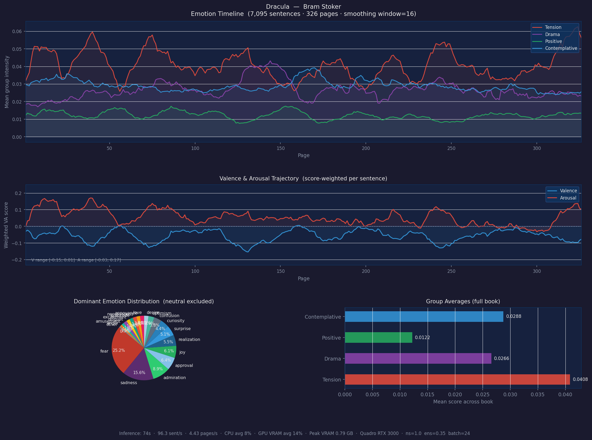

# emotion-reader

**Turns a novel into an emotional map: per-sentence emotions, and a Valence/Arousal curve across
the pages.**

This is the *text side* of [**Music Supervisor**](https://github.com/medusa606/manuscript_app) (working title), an app
that scores music to the book you're reading. emotion-reader works out how each part of the story
*feels*. Its sister repo [**music_mood**](https://github.com/medusa606/music_mood) works out how each
piece of music feels. Matching the two lets the soundtrack follow the drama.



*Dracula, 7,095 sentences over 326 pages. Tension (red) is the strongest group for most of the
book, peaks several times, and climbs again at the climax.*

---

## Where this fits

```text
 ┌──────────────────┐   ┌──────────────────────────┐   ┌──────────────────┐
 │ db_builder       │   │ emotion-reader           │   │ music_mood       │
 │ (book metadata)  │   │ ◄── YOU ARE HERE         │   │ (track VA)       │
 └────────┬─────────┘   └────────────┬─────────────┘   └────────┬─────────┘
          │                          ┆ page-level VA curve      ┆ track VA
          ▼                          ▼                          ▼
 ┌────────────────────────────────────────────────────────────────────────┐
 │ manuscript_app (Android): follow reading position → pick nearest track │
 └────────────────────────────────────────────────────────────────────────┘
                                       ┆ = planned, not wired in yet
```

See the [manuscript_app README](https://github.com/medusa606/manuscript_app#readme) for the full
system picture and project status.

---

## How it works

```text
 Project Gutenberg .txt
        │  strip licence header/footer
        ▼
 NLTK sentence split  (sentences < 4 words dropped)
        │  each sentence assigned a "page" (40 non-blank lines = 1 page)
        ▼
 ┌─────────────────────────────────┐   ┌─────────────────────────────────────┐
 │ SamLowe/roberta-base-go_emotions│   │ j-hartmann/emotion-english-         │
 │ 28 fine-grained labels          │   │ distilroberta-base · 7 Ekman labels │
 └───────────────┬─────────────────┘   └──────────────────┬──────────────────┘
                 └──────────── ensemble blend ────────────┘
                               (Hartmann weight 0.35, mapped onto GoEmotions labels)
                                          ▼
                             neutral suppression
                 (if strong emotions are present, move probability away from "neutral")
                                          ▼
                 each label has a fixed (V, A) point on Russell's circumplex
                 sentence VA = probability-weighted average of those points
                                          ▼
                 page VA = sentence VA weighted by each sentence's dominant score
                                          ▼
                   CSV (per sentence) · JSON (stats + per-page groups) · PNG timeline
```

### Emotion groups

The 28 GoEmotions labels are grouped into five musical "moods" for plotting:

| Group | Labels | Musical feel |
|-------|--------|--------------|
| **Tension / Danger** | fear, nervousness, anger, annoyance | high arousal, negative |
| **Drama / Darkness** | disgust, grief, sadness, remorse | low arousal, negative |
| **Positive / Uplifting** | joy, love, admiration, excitement, amusement, gratitude, pride, optimism, relief | positive |
| **Contemplative** | surprise, curiosity, realization, confusion, approval, desire | mid valence, some arousal |
| **Neutral / Flat** | neutral, caring, disapproval, embarrassment, disappointment | excluded from the timeline |

Valence and Arousal are both on a **−1 … +1** scale. For example, `fear` is (−0.72, +0.82),
`sadness` is (−0.72, −0.25) and `joy` is (+0.82, +0.72). The full table is `EMOTION_META` in
[`analyse_book.py`](analyse_book.py).

---

## Two ways to use it

### 1. `analyse_book.py`: whole-book batch analysis (CLI)

Processes every sentence of a book on the GPU and writes results to `output/`.

```bash
python analyse_book.py --list                 # show the built-in books
python analyse_book.py --book 345             # Dracula (default)
python analyse_book.py --book 84 --batch 32   # Frankenstein, bigger batches
python analyse_book.py --book 1400 --device -1  # CPU only (slow)
```

| Flag | Default | Meaning |
|------|---------|---------|
| `--book` | `345` | Project Gutenberg ID (must be in the built-in list) |
| `--batch` | `24` | Inference batch size; raise it if you have the VRAM |
| `--device` | `0` | CUDA device index, `-1` for CPU |
| `--out` | `output` | Output directory |
| `--ns` | `1.0` | Neutral-suppression strength (0 = off) |
| `--ew` | `0.35` | Ensemble weight given to the Hartmann model |
| `--min` | `0.05` | Minimum score for a label to count as "dominant" |

Built-in books: Pride and Prejudice (1342), Moby Dick (2701), The Picture of Dorian Gray (174),
The Adventures of Sherlock Holmes (1661), Frankenstein (84), Dracula (345), Great Expectations (1400).

**Outputs** (`<slug>` is the lower-cased title, e.g. `dracula`):

| File | Contents |
|------|----------|
| `<slug>_sentences.csv` | One row per sentence: `sentence_idx, page, sentence, dominant, dominant_score, dominant_group, va_v, va_a, score_<label>…` (all 28 labels) |
| `<slug>_stats.json` | Run settings, performance (sentences/sec, VRAM, GPU) and `page_summaries` (mean group intensity per page) |
| `<slug>_timeline.png` | Group timeline, VA trajectory, dominant-emotion pie, and group averages |

**Performance:** on a laptop Quadro RTX 3000, Dracula runs at about 96 sentences/sec (74 s for the
whole book) using under 1 GB of VRAM.

### 2. `app.py`: interactive web demo (Flask)

A page-by-page reader that highlights each sentence with its top emotions, so you can tune
settings by eye.

```bash
python app.py          # then open http://localhost:5000
```

| Endpoint | Method | Purpose |
|----------|--------|---------|
| `/` | GET | Demo UI (`templates/index.html`) |
| `/api/books` | GET | Built-in book list |
| `/api/fetch-book?id=345&page=1` | GET | One 40-line page of book text, plus `total_pages` |
| `/api/analyse` | POST | Analyse text. Body: `{"text", "granularity": "sentence"\|"paragraph", "context_window", "use_ensemble", "ensemble_weight", "neutral_suppression", "threshold"}` |

The web demo has one extra option the CLI lacks: a **context window**, which classifies each
sentence together with its neighbours (the target is wrapped in `[TARGET]…[/TARGET]`).

---

## Setup

Requires Python 3.10+. A CUDA GPU is strongly recommended; both scripts default to `device=0`.

```bash
python -m venv .venv
source .venv/bin/activate          # Windows: .venv\Scripts\activate
pip install -r requirements.txt    # install the CUDA build of torch first if you have a GPU
```

The two Hugging Face models (~500 MB in total) and NLTK's `punkt_tab` tokenizer are downloaded
automatically on first run.

> `app.py` loads its models on `device=0` at import time. On a machine without a GPU, change
> `device=0` to `device=-1` in the two `pipeline(...)` calls.

---

## Repo layout

```text
analyse_book.py      whole-book CLI analyser (current, "version 3")
app.py               Flask demo server
templates/index.html demo UI
output/              sample results for Dracula, Frankenstein and Great Expectations
main.py              PyCharm placeholder, not used
```

## Known limitations and next steps

* **The VA range is compressed.** Page-level VA for Dracula only spans roughly V −0.15…+0.01 and
  A −0.03…+0.17. Before matching against music, normalise the curve per book (e.g. min-max or z-score).
* **Pages are synthetic** (40 non-blank lines). Chapter detection (`CHAPTER …` headings) would
  give natural places to change track.
* **Only public-domain Gutenberg texts** in a hard-coded list. In the app, readers will supply
  their own ebook, so this needs an EPUB/text import path. Because the models are too heavy for a
  phone, run the analysis server-side and return just the VA curve. Curves can then be cached per
  ISBN, so each book only has to be analysed once.
* **No export for the app yet.** A compact per-book JSON (`[{page, v, a, group}]`) is the obvious
  hand-off format.
* **Leitmotifs:** running NER (e.g. spaCy) over the sentence CSV would show which characters are
  present on each page.
* Dominance (the "D" in VAD) isn't computed.
